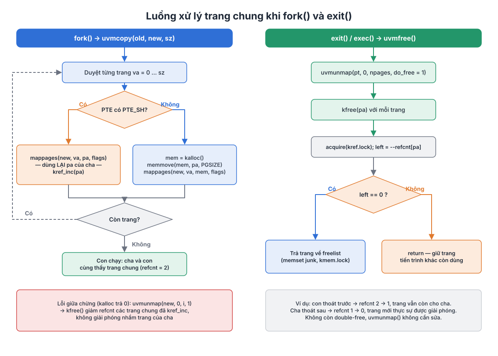
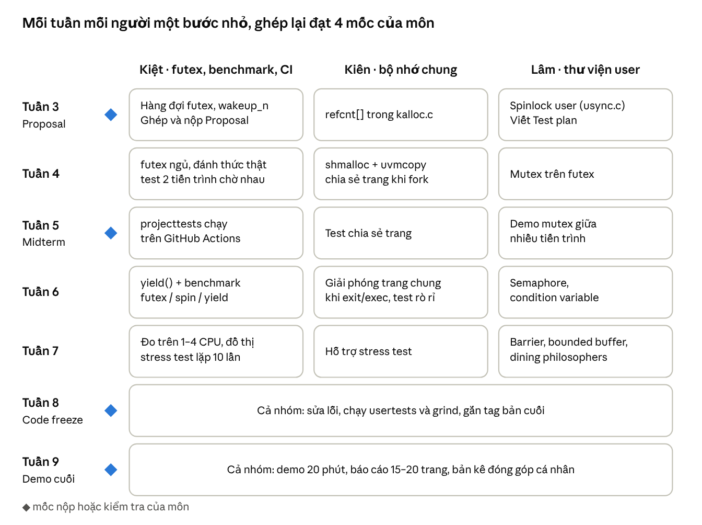

# Design Proposal – Project 26107: Futexes, semaphores, condition variables

Course: Operating Systems – 20261 · Nhóm: Phạm Nguyễn Anh Kiệt (20233483), Đặng Trung Kiên (20233473), Trần Ngọc Lâm (20223714)

Bản nháp Tuần 2: Kiệt đã viết dàn ý, mục 1, mục 2 và mục 8; các mục còn lại do Kiên và Lâm viết tiếp, nộp bản hoàn chỉnh (2–3 trang) ở Tuần 3. Bản Word để nộp: [`Design_Proposal_26107.docx`](Design_Proposal_26107.docx).

| Mục | Nội dung | Người viết |
| --- | --- | --- |
| 1. Giới thiệu và mục tiêu | Bài toán, giải pháp futex, sản phẩm demo | Kiệt |
| 2. Giao diện system call | futex_wait, futex_wake, shmalloc | Kiệt (shmalloc: Kiên) |
| 3. Cấu trúc dữ liệu kernel | Hàng đợi futex, refcnt[], cờ PTE_SH | Kiệt + Kiên |
| 4. Bộ nhớ dùng chung | shmalloc, uvmcopy, kfree với refcount | Kiên |
| 5. Thư viện tầng user | mutex, semaphore, condition variable, barrier | Lâm |
| 6. Danh sách file bị sửa | File, thay đổi, người phụ trách | Cả nhóm |
| 7. Kế hoạch kiểm thử | projecttests, CPUS=1/4, rò rỉ trang, usertests | Lâm + Kiệt |
| 8. Kế hoạch theo tuần | Tuần 3 → Tuần 9 | Kiệt |

## 1. Giới thiệu và mục tiêu

Dự án bổ sung futex vào xv6-riscv để các tiến trình đồng bộ với nhau mà không tốn CPU khi chờ, rồi xây thư viện mutex, semaphore, condition variable và barrier ở tầng user trên nền đó.

**Bài toán.** xv6 gốc chỉ có spinlock và sleeplock dùng bên trong kernel. Chương trình user muốn chờ một khóa chỉ có hai cách: quay vòng kiểm tra (spin), tốn trọn một CPU, hoặc gọi `pause` rồi thử lại, vẫn tốn chuyển ngữ cảnh vô ích. Các tiến trình cũng chưa có vùng nhớ chung để đặt biến khóa.

**Giải pháp.** Futex (fast userspace mutex) tách hai trường hợp:

- Không tranh chấp: khóa và mở khóa chỉ bằng lệnh nguyên tử RISC-V ở tầng user, không vào kernel.
- Có tranh chấp: tiến trình gọi `futex_wait` để ngủ trong kernel; tiến trình nhả khóa gọi `futex_wake` để đánh thức.
- Khóa định danh là địa chỉ vật lý của biến futex, nên hai tiến trình dùng chung một trang nhớ (qua `shmalloc` + `fork`) sẽ chờ trên cùng một khóa.

**Sản phẩm cuối kỳ.**

- System call `futex_wait`, `futex_wake` và `shmalloc` trong kernel.
- Thư viện đồng bộ tầng user: mutex, semaphore, condition variable, barrier.
- Bộ test một lệnh (`projecttests`) in PASS/FAIL: bounded buffer, dining philosophers, barrier, test lỗi tham số, test rò rỉ trang.
- Chương trình benchmark so sánh futex, spinlock và yield lock trên 1–4 CPU.
- Demo: dining philosophers chạy không deadlock và đồ thị benchmark.
- Mở rộng nếu kịp: reader–writer lock, mutex có priority inheritance.

## 2. Giao diện system call

Nhóm thêm ba system call; `futex_wait` và `futex_wake` (số 23, 24) đã có khung trên nhánh `main` từ Tuần 2, `shmalloc` sẽ cài ở Tuần 4.

| System call | Số | Ý nghĩa | Trả về |
| --- | --- | --- | --- |
| `int futex_wait(int *addr, int val)` | 23 | Nếu `*addr == val` thì ngủ cho tới khi có `futex_wake` trên cùng địa chỉ | 0 khi được đánh thức; -1 nếu `*addr != val` hoặc `addr` không hợp lệ |
| `int futex_wake(int *addr, int n)` | 24 | Đánh thức tối đa `n` tiến trình đang chờ trên `addr` | Số tiến trình đã đánh thức; -1 nếu `n <= 0` hoặc `addr` không hợp lệ |
| `void *shmalloc(int npages)` | 25 | Cấp `npages` trang nhớ dùng chung, tiến trình con sau `fork()` thấy cùng trang (Kiên ghi chi tiết ở mục 4) | Địa chỉ ảo của vùng nhớ; 0 nếu lỗi |

**Quy tắc với `addr`:**

- Phải căn lề 4 byte và nằm trong không gian user đã ánh xạ (`PTE_V` và `PTE_U`).
- Kernel kiểm tra bằng `futex_key()` (Lâm viết, `kernel/vm.c`): trả về địa chỉ vật lý làm khóa, hoặc 0 nếu địa chỉ sai.
- Hai tiến trình trỏ vào cùng một biến trong trang dùng chung luôn ra cùng một khóa, dù địa chỉ ảo khác nhau.

**Vì sao `futex_wait` cần tham số `val`.** Giữa lúc user thấy khóa bận và lúc vào kernel, tiến trình khác có thể đã nhả khóa và gọi `futex_wake`. Kernel đọc lại `*addr` trong lúc giữ khóa của hàng đợi; nếu giá trị đã khác `val` thì trả về ngay thay vì ngủ, tránh mất tín hiệu đánh thức (lost wake-up).

**Trạng thái hiện tại (Tuần 2).** Hai hàm `sys_futex_wait`, `sys_futex_wake` trong `kernel/sysproc.c` đọc tham số và kiểm tra địa chỉ, chưa chờ hoặc đánh thức thật. Chương trình `futexstub` kiểm tra 5 trường hợp tham số đúng và sai.

**Câu hỏi mở:**

- [ ] Cấu trúc hàng đợi futex: dùng thẳng khóa vật lý làm `chan` trong `struct proc`, hay bảng băm có spinlock theo từng bucket (chốt ở Tuần 3).
- [ ] Benchmark "yield lock" cần system call `yield()` mà xv6 chưa có; dự kiến Kiệt thêm cùng chương trình benchmark ở Tuần 6.

## 3. Cấu trúc dữ liệu kernel (Kiệt + Kiên, viết ở Tuần 3)

- Hàng đợi futex: cấu trúc đã chọn ở câu hỏi mở mục 2, khóa bảo vệ, cách `wakeup_n` đánh thức tối đa n tiến trình (Kiệt).
- `refcnt[(PHYSTOP - KERNBASE) / PGSIZE]` trong `kernel/kalloc.c` với khóa riêng (Kiên).
- Cờ `PTE_SH` = bit RSW 8 của PTE đánh dấu trang dùng chung (Kiên).

## 4. Bộ nhớ dùng chung (Kiên)

Futex chỉ có tác dụng giữa các tiến trình khi chúng cùng nhìn thấy một biến. xv6 gốc không có bộ nhớ dùng chung: `fork()` gọi `uvmcopy()` sao chép mọi trang của cha. Nhóm thêm trang nhớ ẩn danh dùng chung và bộ đếm tham chiếu để trang chỉ được giải phóng khi không còn tiến trình nào dùng.

**`shmalloc(npages)`.**

- Cấp `npages` trang mới bằng `kalloc()`, xóa về 0, ánh xạ liên tiếp từ `va = PGROUNDUP(p->sz)` với cờ `PTE_R | PTE_W | PTE_U | PTE_SH`, sau đó cập nhật `p->sz = va + npages * PGSIZE` và trả về `va`.
- Vùng chung nằm ngay trên heap và nằm trong `p->sz`, nên `exit()`, `exec()` và `sbrk` âm tự thu hồi nó qua `uvmunmap()` như bộ nhớ thường, không cần sửa thêm.
- Trang được cấp ngay, không đi qua cấp phát lười `vmfault()`, để PTE đã tồn tại trước khi `fork()`; nếu không, `uvmcopy()` sẽ bỏ qua trang và con không thấy vùng chung.
- Lỗi (`npages <= 0`, `npages > 16` hoặc hết bộ nhớ): gỡ các trang đã cấp bằng `uvmunmap()` và trả về 0.

**Cờ `PTE_SH` = bit 8.** PTE của Sv39 dành bit 8–9 (RSW) cho phần mềm, phần cứng bỏ qua nên việc đánh dấu không ảnh hưởng dịch địa chỉ. Bit 0–4 (V, R, W, X, U) đã dùng, bit 5–7 (G, A, D) có ý nghĩa với phần cứng. `PTE_FLAGS()` lấy 10 bit thấp (`0x3FF`) nên `PTE_SH` được giữ nguyên khi chép cờ sang bảng trang con.

**Những gì phải sửa.**

| Vị trí | Thay đổi |
| --- | --- |
| `kernel/kalloc.c` | Thêm `int refcnt[(PHYSTOP - KERNBASE) / PGSIZE]` (32 768 ô, 128 KB) với khóa riêng `kref.lock`; chỉ số của trang là `(pa - KERNBASE) / PGSIZE` |
| `kalloc()` | Trang lấy từ freelist phải có `refcnt = 0`, đặt thành 1 |
| `kfree()` | Giảm `refcnt`; chỉ đưa trang về freelist khi về 0. Nếu `refcnt <= 0` trước khi giảm thì `panic("kfree: double free")` |
| `freerange()` | Đặt `refcnt = 1` trước khi gọi `kfree()` cho từng trang lúc khởi động; nếu không, `kfree()` thấy 0 và panic ngay khi boot |
| `uvmcopy()` | PTE có `PTE_SH`: `mappages()` cùng PA sang bảng trang con và gọi `kref_inc(pa)`, thay vì `kalloc()` + `memmove()` |
| `uvmunmap()` | Không sửa: vẫn gọi `kfree()`, bộ đếm quyết định trang có bị giải phóng hay không |

Thêm `kref_inc()` và `kref_get()` vào `kernel/defs.h`. `kalloc()` và `kfree()` không bao giờ giữ `kref.lock` và `kmem.lock` cùng lúc nên không có deadlock.

**Ví dụ.** Cha gọi `shmalloc(1)` rồi `fork()`: trang chung có `refcnt = 2`, `futex_key()` của cha và con trả về cùng địa chỉ vật lý. Con thoát trước: `refcnt` về 1, cha vẫn đọc được giá trị con ghi. Cha thoát sau: `refcnt` về 0, trang mới trở lại freelist.

**Lộ trình.** Tuần 3: `refcnt[]` trong `kalloc.c`, `usertests` vẫn PASS. Tuần 4: `PTE_SH`, `sys_shmalloc()`, sửa `uvmcopy()` và chương trình test cha–con dùng chung trang.

## 5. Thư viện tầng user (Lâm)

- `user/usync.c`: spinlock, mutex 3 trạng thái (0 tự do, 1 bị khóa, 2 bị khóa và có người chờ), semaphore, condition variable, barrier.
- Sơ đồ trạng thái mutex và semaphore: lấy từ Figma.

## 6. Danh sách file bị sửa (cả nhóm)

| File | Thay đổi | Người phụ trách |
| --- | --- | --- |
| `kernel/syscall.h`, `kernel/syscall.c` | Số hiệu và bảng syscall | Kiệt |
| `kernel/sysproc.c` | `sys_futex_wait`, `sys_futex_wake`, `sys_yield` | Kiệt |
| `kernel/proc.c` | Hàng đợi futex, `wakeup_n` | Kiệt |
| `kernel/vm.c` | `futex_key()` | Lâm |
| `kernel/vm.c` | `uvmcopy()` với `PTE_SH` | Kiên |
| `kernel/kalloc.c` | `refcnt[]`, `kalloc`, `kfree` | Kiên |
| `kernel/riscv.h` | `PTE_SH` | Kiên |
| `user/usync.c`, `user/usync.h` | Thư viện đồng bộ | Lâm |
| `user/futexbench.c` | Benchmark futex/spin/yield | Kiệt |
| `user/projecttests.c` | Khung chạy test PASS/FAIL | Kiệt |

## 7. Kế hoạch kiểm thử (Lâm + Kiệt, viết ở Tuần 3)

- Test chức năng cho từng syscall, gồm tham số sai và mã lỗi trả về.
- Bounded buffer, dining philosophers, barrier; chạy với `CPUS=1` và `CPUS=4`, lặp ít nhất 10 lần.
- Đếm số trang trống trước và sau bộ test để phát hiện rò rỉ.
- `usertests` và `grind` gốc vẫn phải PASS; tất cả chạy tự động trên GitHub Actions.
- Benchmark: mỗi điểm dữ liệu chạy ít nhất 5 lần, báo cáo trung bình và độ lệch.

## 8. Kế hoạch theo tuần (Kiệt)

Mỗi tuần mỗi người một bước nhỏ, các bước ghép lại để đạt bốn mốc của môn: Proposal (Tuần 3), Midterm (Tuần 5), Code freeze (Tuần 8), Demo cuối (Tuần 9).

Tuần 5 cần mutex trên futex chạy giữa nhiều tiến trình, nên ba việc của Tuần 4 (futex thật, shmalloc, mutex) phải xong cùng lúc.
